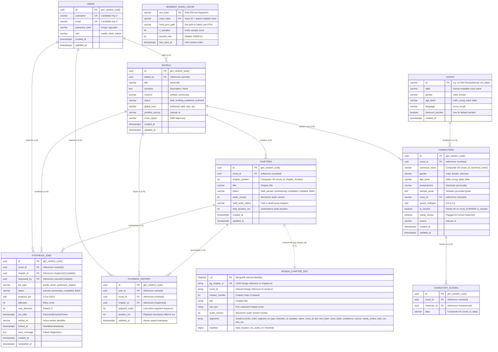
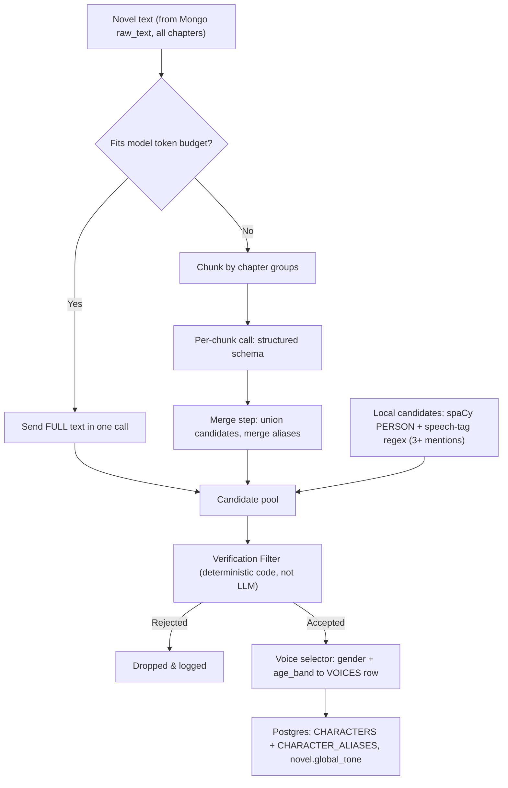
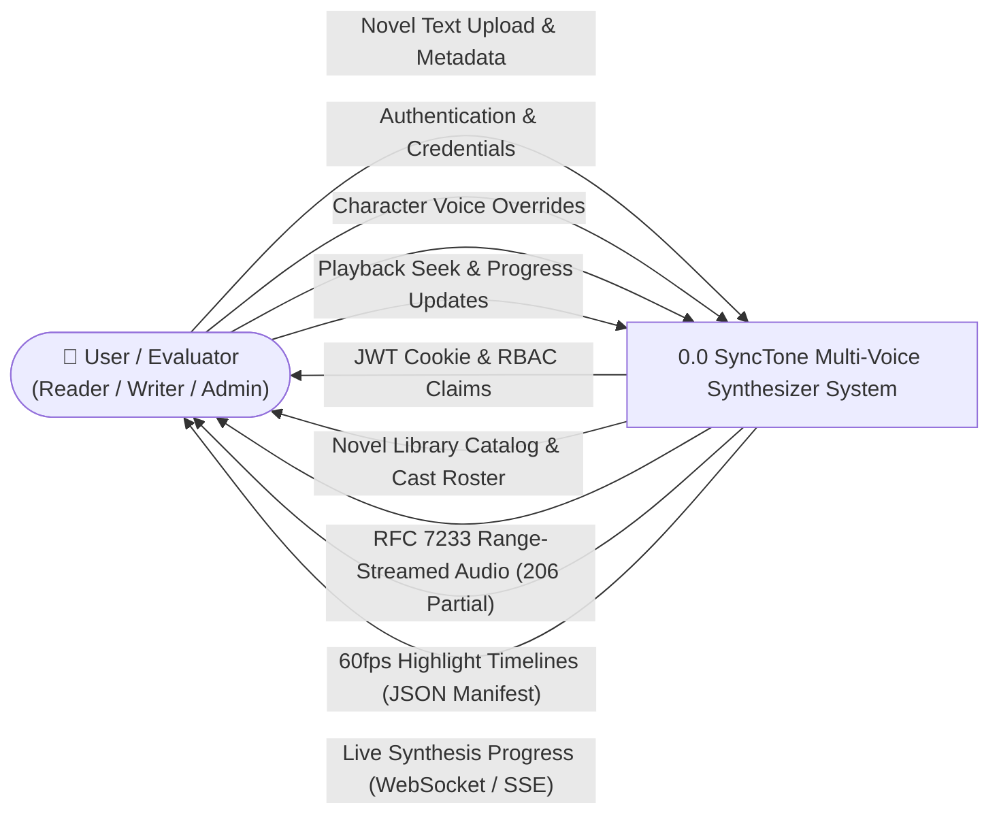
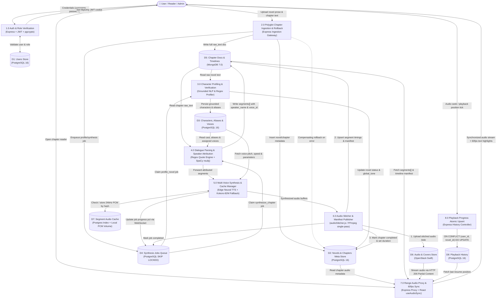

# SyncTone — Capstone Architecture Plan (Rev. 8)

> Rev. 8 applies verified polyglot persistence alignment across PostgreSQL 16, MongoDB 7.0, and OpenStack Swift. All database schemas, entity relationships, tech stack definitions, and data flow diagrams are synchronized with `0001_initial_schema.sql`, Mongoose `Chapter` contracts, and the 6-service Docker Compose architecture.

---

## 0. Finalized Decisions & Timeframe

* **Recounted Speech (P.S. Feature)**: **Voice switch only.** The book's exact words are preserved verbatim to maintain 1:1 text-audio alignment for `requestAnimationFrame` text highlighting with zero generative text hallucination. The voice switches to the character during the recounted clause and immediately reverts to the narrator.
* **Target Delivery Timeline**: **20-Day Fast-Track Sprint** (Total submission deadline: 41 days). The project is engineered to achieve a complete, feature-frozen MVP by **Day 20**, leaving the remaining 21 days as an extensive buffer for benchmark evaluation, report writing, and viva presentation rehearsal.

---

## 1. Scope & Content Strategy

| Phase | Contents | Target |
|---|---|---|
| **Phase 1 (Core MVP - Days 1–17)** | Login with roles (`reader`, `writer`, `admin`). **Verified channel only.** Admin adds novels via clean upload form. Multi-pass AI character discovery (Gemini Flash + dual-signal extraction). Line-by-line chapter attribution. Per-chapter on-demand TTS. Opus/MP3 audio stored in OpenStack Swift. Synced React reader with 60fps highlighting. | **Must Ship (Day 17)** |
| **Phase 2 (Hardening & Demos - Days 18–20)** | Pre-tuned *Harry Potter* demo (local evaluation only). Public-domain *Sherlock Holmes* demo. Two-chapter Project Gutenberg benchmark evaluation. Code freeze. | **Feature Freeze (Day 20)** |
| **Phase 3 (Post-MVP Buffer - Days 21–41)** | Writer role and upload portal (with `tts-dom-cleaner`). Community channel with disclaimer. Recounted-speech voice switching. Report & Viva preparation. | Buffer & Expansion |

**Demo content:**
- **Public deployment:** public-domain novels only (Project Gutenberg, e.g. *The Adventures of Sherlock Holmes*).
- **Harry Potter:** runs **on your local machine only.** Its character portfolio is **entered by hand by the admin** (Verified channel), so the book is **never sent to a third-party LLM API.** That also avoids API terms-of-service questions.

---

## 2. Tech Stack & Infrastructure

SyncTone is orchestrated as a 6-service polyglot architecture in Docker Compose:

| Layer | Technology | Role |
|---|---|---|
| **Frontend Web Client** | **React 18 + Vite 5 + Tailwind CSS 3** (Pure JavaScript ES2022+) | Responsive webnovel reader (WTR-Lab style), catalog browsing, and character drawer. A 60fps `requestAnimationFrame` loop drives `useAudioSync` binary-search highlighting; live progress consumed via WebSocket. |
| **Input Cleaning** | **`tts-dom-cleaner`** (npm package) | Client-side DOM/text cleanup before upload to strip web novel artifacts, site navigation, and ruby tags. |
| **API Gateway & Primary Synthesis** | **Express.js (Node.js 20+ / CommonJS)** | Auth (`httpOnly` JWT cookie + `pgcrypto` bcrypt), RBAC (`reader`, `writer`, `admin`), connection-pooled PostgreSQL (`pg`), MongoDB ODM (`mongoose`), novel and chapter routes, text parsing (`textParser.js`), speaker attribution (`attribution.js`), voice profiling (`voiceProfiler.js`), audio stitching (`audioStitcher.js`), and RFC 7233 Swift audio proxy. |
| **Primary TTS Engine** | **Microsoft Edge Neural TTS (`msedge-tts`)** | Primary multi-voice neural synthesis (24kHz 48kbps MP3) streaming authentic British character voices (Harry, Hermione, Ron, Dumbledore, Snape, McGonagall, Ryan Narrator). |
| **Offline Worker Daemon & Migrations** | **Python 3.11 (`kokoro-tts-backend`)** | Background daemon and authoritative schema migration runner (**Alembic** `0001_initial_schema.py`). SpaCy NLP (`en_core_web_sm`) dependency parsing, Kokoro-82M ONNX / PyTorch TTS fallback claiming jobs via `SELECT ... FOR UPDATE SKIP LOCKED`. |
| **Relational DB** | **PostgreSQL 16 (`synctone-postgres`)** (authoritative) | Strict 3NF/BCNF relational DBMS: users, roles, novel metadata, chapter metadata, characters, aliases, voices catalog (20 seeded voices: 12 Kokoro + 8 Edge Neural), transactional job queue (`synthesis_jobs`), LRU segment audio cache (`segment_audio_cache`), and atomic playback resume (`playback_history` + `reading_progress` view). |
| **Document DB** | **MongoDB 7.0 (`synctone-mongo`)** | High-performance document store (`chapters` collection via Mongoose `Chapter` model) linked via `pg_chapter_id` UUID: full raw text, attributed segments array (with `order`, `segment_id`, `type`, `text`, `character_id`, `speaker_id`, `speaker_name`, `voice_id`, `confidence`, `source`, `needs_review`), and playback manifest (`total_duration_ms`, `audio_url`, `timeline[]`). |
| **Object Storage** | **OpenStack Swift (`synctone-swift`)** | Final `.opus`/`.mp3` audio blobs (`novel-chapters`) and cover images (`novel-covers`). Streamed through Express Range Proxy with HTTP 206 Partial Content, automatic 401 token refresh retry, and 416 range validation. |
| **LLM** | Hosted long-context model, **Gemini Flash-class** | Cast reconciliation, tone extraction, and character profiling. Hand-tuned verified portfolios bypass LLM calls entirely. |
| **Hosting & Orchestration** | **6-Service Docker Compose** | Multi-container stack (`synctone-postgres`, `synctone-mongo`, `synctone-swift`, `synctone-api`, `synctone-worker`, `synctone-frontend`). |

---

## 3. Data Placement: Which Store Owns What

Each fact has exactly one authoritative owner. Copies are labelled *derived*.

| Data | Owner | Copy (derived) | Why |
|---|---|---|---|
| Users, roles | Postgres (`users`) | — | Constraints and auth need ACID guarantees. |
| Novel metadata, channel, status | Postgres (`novels`) | — | Relational and filterable catalog. |
| Chapter metadata (`status`, `swift_audio_object`, `total_duration_ms`, `audio_version`) | **Postgres (`chapters`)** | — | Authoritative relational state; kept decoupled from raw text. |
| Chapter raw text | **Mongo (`chapters.raw_text`)** | — | Large text that's read whole. Keeps Postgres small. |
| Attributed segments + `start_ms/end_ms` | **Mongo (`chapters.segments[]`)** | — | Read as one document per chapter. Stores `speaker_name` and `voice_id` directly for fast reader rendering. |
| Characters, aliases, voices | Postgres (`characters`, `character_aliases`, `voices`) | — | Foreign keys, cascading deletes, and uniqueness constraints. |
| Jobs, PCM cache index | Postgres (`synthesis_jobs`, `segment_audio_cache`) | — | `SKIP LOCKED`, row locking, and LRU cache tracking. |
| Playback history / reading progress | **Postgres (`playback_history`)** | — | Atomic upserts via `UNIQUE(user_id, novel_id)`. `reading_progress` is an SQL compatibility view. |
| Opus/MP3 audio, covers | Swift (`novel-chapters`, `novel-covers`) | — | Binary objects streamed via Range proxy. |
| PCM cache files | Local volume on the worker host | — | Temporary synthesis cache; never in Swift. |

**Why MongoDB at all?**
1. The project requires both a relational and a document database.
2. A chapter is document-shaped: raw text plus an ordered array of segments, always read and written together.
3. Postgres JSONB could hold this too. We will **benchmark both** on one real chapter (fetch time, document size) and report the measured numbers in the academic evaluation.

---

## 4. Entity-Relationship (ER) Diagram

### Architectural Notes & Constraints
1. **Attribution Normalization**: `CHARACTER_ALIASES` maps "Harry", "Potter" and "Mr Potter" to one canonical character row. `UNIQUE(novel_id, alias)` guarantees an alias cannot point to multiple characters in the same novel.
2. **Nullable Job Foreign Keys**: `SYNTHESIS_JOBS` features `chapter_id` (nullable FK) enforced by `CHECK ((job_type = 'profile_novel' AND chapter_id IS NULL) OR (job_type = 'synthesize_chapter' AND chapter_id IS NOT NULL))`.
3. **Atomic Playback Upsert**: `PLAYBACK_HISTORY` maintains atomic user resume position with `UNIQUE(user_id, novel_id)`. The SQL view `reading_progress` is provided as an exact compatibility layer (`SELECT * FROM playback_history`).
4. **Voice Catalog Cleanliness**: `VOICES` matches `0001_initial_schema.sql` (no `engine` column in SQL schema; engine resolution is handled cleanly by voice ID prefix/catalog).
5. **Direct Reader Playback Optimization**: Mongo segments store **`voice_id` and `speaker_name` directly** alongside `character_id`, `start_ms`, and `end_ms`. This enables zero-join reader playback and instantaneous highlight synchronization on the client.
6. **Cross-Database Boundary**: The link between `CHAPTERS` and `MONGO_CHAPTER_DOC` is an application-level reference keyed by `pg_chapter_id` (UUID). No foreign keys cross the database boundary.
7. **LRU Audio Caching**: `SEGMENT_AUDIO_CACHE` is a standalone lookup table keyed by `(text_hash, voice_hash)`. `last_used_at` drives LRU cache cleanup on local disk.

---

## 5. Key Design Rules & Idempotency

### 5.1 Relational Constraints
- `UNIQUE(novel_id, chapter_number)` on chapters
- `UNIQUE(novel_id, canonical_name)` on characters
- `UNIQUE(novel_id, alias)` on character_aliases
- `UNIQUE(user_id, novel_id)` on playback_history (atomic upsert)
- Partial unique index: `CREATE UNIQUE INDEX ON characters(novel_id) WHERE is_narrator = true;`
- `voices.reserved_narrator`: the narrator voice is excluded from automatic character assignment
- MongoDB: unique index on `pg_chapter_id`, and compound index on `(novel_id, chapter_number)`

### 5.2 Cross-Database Write Order (Worker, per chapter)
A crash at any step leaves a state that a retry repairs, because each step is idempotent and PostgreSQL is written **last**:
1. Synthesize, then upload the Opus/MP3 file to Swift as `{novel_id}/{chapter_id}/v{audio_version+1}.opus`. This is a new object name, so it never overwrites audio currently being served.
2. **Upsert** the Mongo document keyed on `pg_chapter_id`: segments, timings, and `audio_version = n+1`.
3. In one PostgreSQL transaction: set `chapters.status = 'completed'`, update `swift_audio_object`, `total_duration_ms` and `audio_version = n+1`, and mark the job `completed`.

Readers only see the new audio once step 3 commits. If Mongo already holds `n+1` timings while Postgres still says `n`, the API serves the version Postgres names. Old Swift objects are swept during nightly garbage collection.

### 5.3 Compensating Rollback during Ingestion
During chapter creation (`POST /api/novels/:id/chapters`):
1. Express starts an explicit PostgreSQL transaction: `BEGIN`.
2. Inserts metadata into PostgreSQL `chapters`.
3. Creates the MongoDB document in `chapters` with `raw_text` and `pg_chapter_id`.
4. If either step fails or times out, Express issues `ROLLBACK` to PostgreSQL and calls `Chapter.deleteOne({ pg_chapter_id })` in MongoDB, preventing orphan records in both stores.

### 5.4 Job Queue & Reaper Semantics
- **Claim:** `SELECT ... FOR UPDATE SKIP LOCKED`, filtered by `status='queued' AND run_after <= now() AND attempts < max_attempts`.
- **Heartbeat:** the worker refreshes `locked_at` after every processed segment.
- **Reaper:** executed in a transactional cron:
  - Stale with `attempts >= max_attempts`: mark the job `failed` and its chapter `failed`.
  - Stale with attempts remaining: re-queue with `run_after = now() + 15s * 2^LEAST(attempts,4)` (30s, 60s, 120s, 240s).
- **Progress:** WebSocket / SSE broadcast pushes `synthesis_progress` events to connected frontend clients.

---

## 6. AI & NLP Attribution Pipeline

### 6.1 Character Discovery & Profiling Flow

### 6.2 Deterministic Verification Guard
| Check | Rule | On Failure |
|---|---|---|
| **Name Grounding** | `canonical_name` **or any alias** appears as a **whole word** (`\b{name}\b`) | Reject |
| **Quote Grounding** | `sample_quote` is **required**, and after normalising (NFKC, straight quotes, collapsed whitespace) it appears literally | Reject |
| **Gender Evidence** | Count pronouns in the sentence window after each mention, discounting "told her/him" object pronouns. Needs 3+ pronouns and 2:1 ratio. | Disagreement: use text evidence and flag `needs_review` |
| **Voice Selection** | Assigned deterministically by code from `VOICES` (matching gender, then age band, preferring unused voices). | Foreign-key safe by construction |

---

## 7. Hosting, Swift & Authentication

**Production:** **One VPS** running Docker Compose with 6 containers:
- `synctone-postgres` (PostgreSQL 16)
- `synctone-mongo` (MongoDB 7.0)
- `synctone-swift` (`bouncestorage/swift-aio` OpenStack Swift)
- `synctone-api` (Express.js Gateway)
- `synctone-worker` (Python 3.11 Daemon)
- `synctone-frontend` (React + Vite Web Client)

**Swift Object Storage Integration:**
- **Worker (Python, `python-swiftclient`)** uploads synthesized audio files directly.
- **Express (JavaScript)** reads from Swift with a **single in-flight token refresh mutex**. On `401 Unauthorized`, it re-authenticates and retries once.
- **Range Proxy (`GET /api/chapters/:id/audio` and `GET /api/stream/:chapter_id`)**:
  1. Validates `httpOnly` JWT cookie and checks user authorization.
  2. Resolves `swift_audio_object` from PostgreSQL.
  3. Validates and forwards HTTP `Range` headers, returning `206 Partial Content` with `Content-Range` or `416 Range Not Satisfiable`.

---

## 8. Data Flow Diagrams (DFDs)

### 8.1 Level 0 DFD (Context Diagram)

---

### 8.2 Level 1 DFD (Verified Subsystem Data Flow)

---

## 9. 4-Phase Implementation Schedule

| Sprint Phase | Focus Area & Milestone Tasks | Status |
|---|---|:---:|
| **Phase 1: Polyglot Infrastructure & Schema Authority** | • 6-Service Docker Compose setup (`synctone-postgres`, `synctone-mongo`, `synctone-swift`, `synctone-api`, `synctone-worker`, `synctone-frontend`). • Alembic migration `0001_initial_schema.py` & standalone SQL `0001_initial_schema.sql` (9 tables in 3NF/BCNF). • Voice catalog seeding (20 voices: 12 Kokoro + 8 Edge Neural). • Mongoose `Chapter` document schema with unique `pg_chapter_id` link. • Automated data engineering test suite (`npm run test:de`). | **`[DONE]`** |
| **Phase 2: Express Gateway & Multi-Voice Engine** | • Express.js REST API Gateway with `httpOnly` cookie JWT & RBAC. • Polyglot chapter ingestion with compensating rollback. • Dual-TTS multi-voice synthesis (Edge Neural primary + Kokoro-82M fallback). • Audio stitcher (`audioStitcher.js`) with 250ms inter-speaker silence frames. • Swift Range streaming proxy (`Range: bytes=`, 206 Partial Content, 401 token refresh). • Deterministic quote parsing & speaker attribution (`textParser.js`, `attribution.js`). • PostgreSQL `SKIP LOCKED` job queue broker & WebSocket progress broadcast. | **`[DONE]`** |
| **Phase 3: Frontend Novel Library & Synced Reader Polish** | • Responsive React 18 + Tailwind CSS 3 webnovel reader (WTR-Lab style). • 60fps `useAudioSync` binary-search highlighting loop. • Novel library catalog with Verified / Community channel tabs and cover art. • Character Roster Drawer with sample quote preview & voice reassignments. • Live WebSocket progress bars for queued synthesis jobs. • Atomic playback history persistence (`POST /api/progress`). | **`[NEXT]`** |
| **Phase 4: End-to-End Testing & Assessment Defense** | • Full demo walkthroughs: *Harry Potter* (local cast) and *Sherlock Holmes* (Gutenberg). • Zombie worker recovery testing with simulated worker crashes. • MongoDB vs PostgreSQL JSONB read performance benchmark evaluation. • Project report, architecture evidence artifacts, and viva presentation deck. | **`[UPCOMING]`** |
