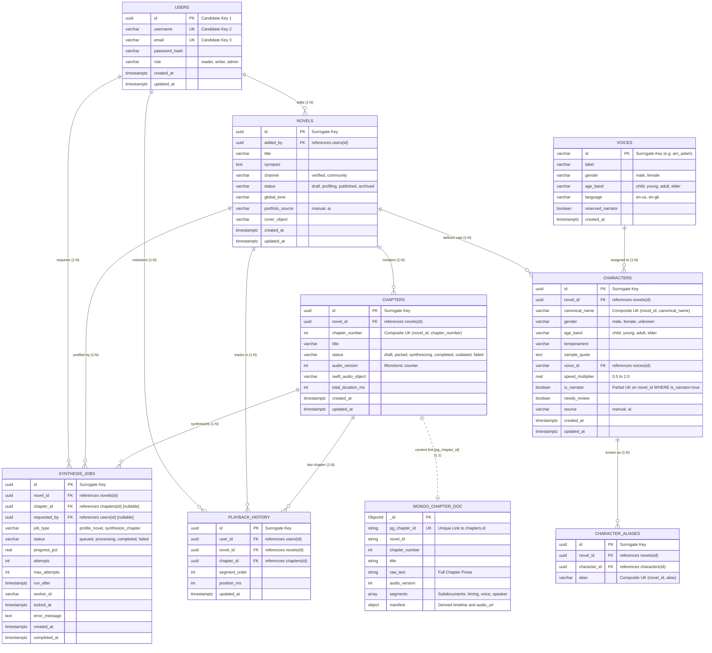

# SyncTone — Data Engineering Evidence & Normalization Specification
**Supplement to SyncTone Master Engineering Brief | Assessment Evidence Artifact**

---

## 1. Polyglot Architecture & Entity-Relationship (ER) Diagram

SyncTone uses a **Polyglot Persistence Architecture**:
* **PostgreSQL 16**: Authority for 3NF/BCNF relational state, transactional integrity, foreign key cascading, and the row-locked task queue (`FOR UPDATE SKIP LOCKED`).
* **MongoDB 7.0**: High-throughput document store for raw prose, tokenized dialogue segment arrays, and derived timeline playback manifests. Linked strictly via `pg_chapter_id` (UUID unique index).



---

## 2. DBMS Relational Normalization Proof (1NF to BCNF)

> [!NOTE]
> **Polyglot Scope Note**: Relational normalization (1NF through BCNF) applies strictly to the PostgreSQL schema. MongoDB chapter documents (`chapters.segments[]`, `chapters.manifest`) are purposefully non-relational document stores optimized for 60fps audio clock polling and hierarchical prose arrays, and are therefore outside relational 3NF analysis.

### 2.1 First Normal Form (1NF)
* **Atomic Attributes**: All PostgreSQL attributes contain strictly scalar, non-decomposable types (`UUID`, `VARCHAR`, `INT`, `BOOLEAN`, `TIMESTAMPTZ`, `REAL`). No multi-valued attributes, repeating groups, or delimited strings.
* **Decomposition of Aliases**: Rather than comma-delimited arrays, character aliases are decomposed into a dedicated relation:
  $$\text{CHARACTER\_ALIASES}(\underline{\text{id}}, \text{novel\_id}, \text{character\_id}, \text{alias})$$
  enforcing `UNIQUE(novel_id, alias)`.
* $\mathbf{1NF\text{ Satisfied}}$ across all 9 PostgreSQL tables.

### 2.2 Second Normal Form (2NF)
* A relation is in 2NF if it is in 1NF and no non-prime attribute is partially dependent on any candidate key (every non-prime attribute depends on the *whole* of every candidate key).
* **Single-Attribute Candidate Keys**: Relations where all candidate keys are single-column (`USERS`, `VOICES`, `NOVELS`, `SYNTHESIS_JOBS`) trivially satisfy 2NF as no proper subset of a single attribute can exist.
* **Composite Candidate Keys**:
  * `CHAPTERS`: Candidate keys $CK_1 = \{\text{id}\}$, $CK_2 = \{\text{novel\_id}, \text{chapter\_number}\}$. Non-prime attributes (`title`, `status`, `audio_version`, `swift_audio_object`, `total_duration_ms`, `created_at`, `updated_at`) depend on the specific chapter of that specific novel, not on `novel_id` alone or `chapter_number` alone. $\implies \mathbf{2NF\text{ Satisfied}}$.
  * `CHARACTERS`: Candidate keys $CK_1 = \{\text{id}\}$, $CK_2 = \{\text{novel\_id}, \text{canonical\_name}\}$. Non-prime attributes (`gender`, `age_band`, `temperament`, `sample_quote`, `voice_id`, `speed_multiplier`, `is_narrator`, `needs_review`, `source`) describe the character entity within the novel and do not depend on `novel_id` alone. $\implies \mathbf{2NF\text{ Satisfied}}$.
  * `CHARACTER_ALIASES`: Candidate keys $CK_1 = \{\text{id}\}$, $CK_2 = \{\text{novel\_id}, \text{alias}\}$, $CK_3 = \{\text{character\_id}, \text{alias}\}$. All attributes are prime (part of at least one candidate key). With zero non-prime attributes, no partial dependencies can exist. $\implies \mathbf{2NF\text{ Satisfied}}$.
  * `SEGMENT_AUDIO_CACHE`: Candidate key $CK_1 = \{\text{text\_hash}, \text{voice\_hash}\}$. Audio waveform metadata (`local_pcm_path`, `n_samples`, `sample_rate`) requires both the text spoken and voice parameters. $\implies \mathbf{2NF\text{ Satisfied}}$.
  * `PLAYBACK_HISTORY`: Candidate keys $CK_1 = \{\text{id}\}$, $CK_2 = \{\text{user\_id}, \text{novel\_id}\}$, $CK_3 = \{\text{user\_id}, \text{chapter\_id}\}$. Non-prime attributes (`segment_order`, `position_ms`, `updated_at`) represent the specific playback bookmark and cannot be determined by `user_id` alone, `novel_id` alone, or `chapter_id` alone. $\implies \mathbf{2NF\text{ Satisfied}}$.

### 2.3 Third Normal Form (3NF) vs. Boyce-Codd Normal Form (BCNF)
A relation is in **3NF** if for every non-trivial functional dependency $X \to Y$:
1. $X$ is a superkey, **OR**
2. Each attribute in $Y \setminus X$ is a **prime attribute** (member of some candidate key).

A relation is in **BCNF** if for every non-trivial functional dependency $X \to Y$, $X$ is strictly a **superkey**.

* **Elimination of Transitive Voice Metadata**: Storing voice properties (label, gender, language) on characters would induce the transitive dependency: $\text{character\_id} \to \text{voice\_id} \to \{\text{label}, \text{gender}, \text{language}\}$. Factoring `VOICES` into an independent reference table eliminates this transitive dependency and update anomalies.
* **Controlled Denormalization & 3NF in `CHARACTER_ALIASES`**:
  * Inherited FD: $\text{character\_id} \to \text{novel\_id}$ (since each character belongs to a single novel).
  * In `CHARACTER_ALIASES`, `character_id` is not a superkey (one character can have multiple aliases).
  * However, $\text{novel\_id}$ is a **prime attribute** in candidate key $\{\text{novel\_id}, \text{alias}\}$.
  * **Result**: Satisfies **3NF** (condition 2 met), but **violates BCNF**.
  * **Architectural Rationale**: Storing `novel_id` directly in `CHARACTER_ALIASES` allows PostgreSQL to enforce `UNIQUE(novel_id, alias)` via a native declarative unique constraint, ensuring no alias collisions within a novel without requiring complex cross-table triggers.
* **Controlled Denormalization & 3NF in `PLAYBACK_HISTORY`**:
  * Inherited FD: $\text{chapter\_id} \to \text{novel\_id}$ (each chapter belongs to a single novel).
  * In `PLAYBACK_HISTORY`, `chapter_id` is not a superkey (multiple users read the same chapter).
  * However, $\text{novel\_id}$ is a **prime attribute** in candidate key $\{\text{user\_id}, \text{novel\_id}\}$.
  * **Result**: Satisfies **3NF** (condition 2 met), but **violates BCNF**.
  * **Architectural Rationale**: Retaining `novel_id` enables the business constraint `UNIQUE(user_id, novel_id)` (one playback bookmark per novel per user) and high-throughput query filtering `WHERE user_id = $1 AND novel_id = $2` without executing a join to `chapters`.
* **Polymorphic Design in `SYNTHESIS_JOBS`**:
  * `chapter_id` is nullable (NULL for `profile_novel` jobs, non-NULL for `synthesize_chapter` jobs).
  * When `chapter_id IS NOT NULL`, $\text{chapter\_id} \to \text{novel\_id}$ exists, but `novel_id` is mandatory for whole-novel profiling jobs. Storing `novel_id` across all job types provides a unified polymorphic queue structure. Satisfies **3NF**.

### 2.4 Table-by-Table Normalization & Constraint Verification Table

| Relation | Candidate Keys (CK) | Prime Attributes | Functional Dependencies ($X \to Y$) | Determinant $X$ is Superkey? | Normal Form Achieved | Design Classification |
|:---|:---|:---|:---|:---:|:---:|:---|
| `USERS` | $\{\text{id}\}$, $\{\text{username}\}$, $\{\text{email}\}$ | $\text{id}, \text{username}, \text{email}$ | $\text{id} \to \text{all}$, $\text{username} \to \text{all}$, $\text{email} \to \text{all}$ | **Yes** | **BCNF** | Normalized |
| `VOICES` | $\{\text{id}\}$ | $\text{id}$ | $\text{id} \to \text{all}$ | **Yes** | **BCNF** | Reference Catalog |
| `NOVELS` | $\{\text{id}\}$ | $\text{id}$ | $\text{id} \to \text{all}$ | **Yes** | **BCNF** | Normalized |
| `CHAPTERS` | $\{\text{id}\}$, $\{\text{novel\_id}, \text{chapter\_number}\}$ | $\text{id}, \text{novel\_id}, \text{chapter\_number}$ | $\text{id} \to \text{all}$, $\{\text{novel\_id}, \text{chapter\_number}\} \to \text{all}$ | **Yes** | **BCNF** | Normalized |
| `CHARACTERS` | $\{\text{id}\}$, $\{\text{novel\_id}, \text{canonical\_name}\}$ | $\text{id}, \text{novel\_id}, \text{canonical\_name}$ | $\text{id} \to \text{all}$, $\{\text{novel\_id}, \text{canonical\_name}\} \to \text{all}$ | **Yes** | **BCNF** | Normalized |
| `CHARACTER_ALIASES` | $\{\text{id}\}$, $\{\text{novel\_id}, \text{alias}\}$, $\{\text{character\_id}, \text{alias}\}$ | All attributes are prime | $\text{id} \to \text{all}$, $\{\text{novel\_id}, \text{alias}\} \to \text{all}$, $\text{character\_id} \to \text{novel\_id}$ | **No** (for $\text{char\_id} \to \text{novel\_id}$) | **3NF** | Controlled Denormalization for `UNIQUE(novel_id, alias)` |
| `SYNTHESIS_JOBS` | $\{\text{id}\}$ | $\text{id}$ | $\text{id} \to \text{all}$ (transitive when $\text{chapter\_id} \ne \text{NULL}$) | **Yes** (on $\text{id}$) | **3NF** | Polymorphic Task Queue |
| `SEGMENT_AUDIO_CACHE` | $\{\text{text\_hash}, \text{voice\_hash}\}$ | $\text{text\_hash}, \text{voice\_hash}$ | $\{\text{text\_hash}, \text{voice\_hash}\} \to \text{all}$ | **Yes** | **BCNF** | Derived Waveform Cache |
| `PLAYBACK_HISTORY` | $\{\text{id}\}$, $\{\text{user\_id}, \text{novel\_id}\}$, $\{\text{user\_id}, \text{chapter\_id}\}$ | $\text{id}, \text{user\_id}, \text{novel\_id}, \text{chapter\_id}$ | $\text{id} \to \text{all}$, $\{\text{user\_id}, \text{novel\_id}\} \to \text{all}$, $\text{chapter\_id} \to \text{novel\_id}$ | **No** (for $\text{chap\_id} \to \text{novel\_id}$) | **3NF** | Controlled Denormalization for `UNIQUE(user_id, novel_id)` |

---

## 3. Representative SQL Queries & Recorded Execution Evidence

### 3.1 Catalog Join Query (Novels + Author + Narrator Voice)
```sql
SELECT
  n.id AS novel_id,
  n.title,
  n.channel,
  n.status,
  u.username AS author,
  c.canonical_name AS narrator_name,
  v.label AS narrator_voice
FROM novels n
JOIN users u ON n.added_by = u.id
LEFT JOIN characters c ON c.novel_id = n.id AND c.is_narrator = true
LEFT JOIN voices v ON c.voice_id = v.id;
```
**Recorded Output**:
```
┌───────────┬───────────────────┬────────────┬─────────┬─────────────┬─────────────────┬───────────────────────────┐
│ novel_id  │ title             │ channel    │ status  │ author      │ narrator_name   │ narrator_voice            │
├───────────┼───────────────────┼────────────┼─────────┼─────────────┼─────────────────┼───────────────────────────┤
│ 10f19949  │ 'A Study in S...' │ 'verified' │ 'draft' │ 'arthur_c'  │ 'Dr. Watson'    │ 'Adam (Narrator Default)' │
└───────────┴───────────────────┴────────────┴─────────┴─────────────┴─────────────────┴───────────────────────────┘
```

### 3.2 Atomic Playback Upsert Query (`ON CONFLICT DO UPDATE`)
```sql
INSERT INTO playback_history (user_id, novel_id, chapter_id, segment_order, position_ms, updated_at)
VALUES ($1, $2, $3, $4, $5, now())
ON CONFLICT (user_id, novel_id) DO UPDATE SET
  chapter_id = EXCLUDED.chapter_id,
  segment_order = EXCLUDED.segment_order,
  position_ms = EXCLUDED.position_ms,
  updated_at = now()
RETURNING id, user_id, novel_id, chapter_id, segment_order, position_ms, updated_at;
```
**Recorded Output**:
```
┌──────────┬──────────┬──────────┬──────────┬───────────────┬─────────────┬──────────────────────────┐
│ id       │ user_id  │ novel_id │ chap_id  │ segment_order │ position_ms │ updated_at               │
├──────────┼──────────┼──────────┼──────────┼───────────────┼─────────────┼──────────────────────────┤
│ 705b6b74 │ d4ef400d │ 10f19949 │ c7ea9b68 │ 2             │ 9200        │ 2026-10-13T19:44:27.920Z │
└──────────┴──────────┴──────────┴──────────┴───────────────┴─────────────┴──────────────────────────┘
```

### 3.3 Task Queue Worker Claim Query (`FOR UPDATE SKIP LOCKED`)
```sql
SELECT id, novel_id, chapter_id, job_type, status, attempts
FROM synthesis_jobs
WHERE status = 'queued' AND run_after <= now() AND attempts < max_attempts
ORDER BY created_at ASC
LIMIT 1
FOR UPDATE SKIP LOCKED;
```
**Recorded Output**:
```
┌──────────┬──────────┬──────────┬─────────────────┬──────────┬──────────┐
│ id       │ novel_id │ chap_id  │ job_type        │ status   │ attempts │
├──────────┼──────────┼──────────┼─────────────────┼──────────┼──────────┤
│ 10edc1fc │ e8eea511 │ null     │ 'profile_novel' │ 'queued' │ 0        │
└──────────┴──────────┴──────────┴─────────────────┴──────────┴──────────┘
```

---

## 4. Data-Quality & Cross-Store Failure Recovery Report

| Test Case | Constraint / Path Checked | Mechanism Tested | Observed Result | Status |
|:---|:---|:---|:---|:---:|
| **Unique Email** | `users.email` | PostgreSQL `users_email_key` | Error `23505` duplicate key rejected | **PASS** |
| **Role Domain** | `users.role` | PostgreSQL `users_role_check` | Error `23514` check violation rejected | **PASS** |
| **Foreign Key** | `novels.added_by` | PostgreSQL `novels_added_by_fkey` | Error `23503` invalid reference rejected | **PASS** |
| **Narrator Limit** | `characters.is_narrator` | Partial UK `uq_characters_narrator_per_novel` | 2nd narrator on same novel rejected | **PASS** |
| **Chapter Ordering**| `chapters.chapter_number` | Composite UK `uq_chapters_novel_chapter_number` | Duplicate chapter index rejected | **PASS** |
| **Job Semantics** | `synthesis_jobs.chk_jobs_type_chapter_match` | Check constraint | Disallowed job_type/chapter combinations rejected | **PASS** |
| **Polyglot Link** | `MongoDB Chapter <-> PostgreSQL chapters` | `pg_chapter_id` unique UUID index | Document matches relational record | **PASS** |
| **Failure Recovery**| Ingestion network/database failure | PostgreSQL `ROLLBACK` + Mongoose `deleteOne` | Zero orphan rows or documents left | **PASS** |
| **Upsert Idempotency**| `playback_history` high-speed seeking | `ON CONFLICT (user_id, novel_id) DO UPDATE` | Exactly 1 row maintained; no duplicate rows | **PASS** |

---

## 5. Verification Commands

To independently run and verify all database tests and data engineering evidence:

```bash
# 1. Run core API Gateway and persistence test suite
npm --prefix novel-audio-synthesizer/backend test

# 2. Run dedicated Data Engineering integrity & constraint validation suite
npm --prefix novel-audio-synthesizer/backend run test:de
```
