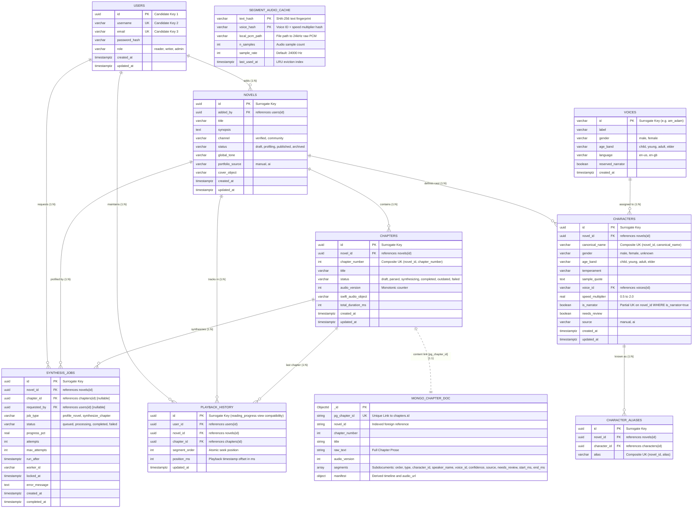

# SyncTone — Data Engineering Evidence & Normalization Specification
**Supplement to SyncTone Master Engineering Brief | Assessment Evidence Artifact**

---

## 1. Polyglot Architecture & Entity-Relationship (ER) Diagram

SyncTone uses a **Polyglot Persistence Architecture**:
* **PostgreSQL 16**: Authority for 3NF/BCNF relational state, transactional integrity, foreign key cascading, and the row-locked task queue (`FOR UPDATE SKIP LOCKED`).
* **MongoDB 7.0**: High-throughput document store for raw prose, tokenized dialogue segment arrays, and derived timeline playback manifests. Linked strictly via `pg_chapter_id` (UUID unique index).



---

## 2. DBMS Normalization Proof (1NF to BCNF)

### 2.1 First Normal Form (1NF)
* **Atomic Attributes**: All relational columns contain strictly scalar atomic types (`UUID`, `VARCHAR`, `INT`, `BOOLEAN`, `TIMESTAMPTZ`, `REAL`). No repeating groups or delimited strings.
* **Alias Decomposition**: Rather than comma-delimited arrays, character aliases are decomposed into a dedicated relation:
  $$\text{CHARACTER\_ALIASES}(\underline{\text{id}}, \text{novel\_id}, \text{character\_id}, \text{alias})$$
  enforcing `UNIQUE(novel_id, alias)`.
* **Polyglot Persistence Design**: Ordered segments and audio timestamps reside in MongoDB (`chapters.segments[]`) to eliminate index bloat and multi-table joins during 60fps audio clock polling.

### 2.2 Second Normal Form (2NF)
* Every non-prime attribute depends on the *whole* of every candidate key.
* **Single-Column Candidate Keys**: Relations with surrogate keys (`users`, `voices`, `novels`, `chapters`, `characters`, `character_aliases`, `synthesis_jobs`) trivially satisfy 2NF as no proper subset of a single attribute exists.
* **Composite Candidate Keys**:
  * `PLAYBACK_HISTORY`: Candidate Key $K = \{\text{user\_id}, \text{novel\_id}\}$. Non-prime attributes (`chapter_id`, `segment_order`, `position_ms`, `updated_at`) depend on the complete composite key. Reading position cannot be determined by user alone or novel alone. $\implies \mathbf{2NF\text{ Satisfied}}$.
  * `SEGMENT_AUDIO_CACHE`: Candidate Key $K = \{\text{text\_hash}, \text{voice\_hash}\}$. Non-prime attributes depend simultaneously on text content and speaker parameters. $\implies \mathbf{2NF\text{ Satisfied}}$.

### 2.3 Third Normal Form (3NF)
* No non-prime attribute is transitively dependent on any candidate key ($X \to Y \implies X$ is a superkey or $Y$ is prime).
* **Elimination of Voice Transitive Dependency**: Storing voice properties (label, gender, language) on characters would induce the transitive dependency: $\text{character\_id} \to \text{voice\_id} \to \{\text{label}, \text{gender}, \text{language}\}$. Decomposing `VOICES` into an independent reference table eliminates transitive dependency and update anomalies.
* **Novels & Users**: User profile attributes are not duplicated in `NOVELS`; all novel attributes depend directly on $\text{novel\_id}$. $\implies \mathbf{3NF\text{ Satisfied}}$.

### 2.4 Boyce-Codd Normal Form (BCNF) Verification Table

| Relation | Candidate Keys | Functional Dependencies ($X \to Y$) | Determinant $X$ is Superkey? | Normal Form Achieved |
|:---|:---|:---|:---:|:---:|
| `USERS` | $\{\text{id}\}$, $\{\text{username}\}$, $\{\text{email}\}$ | $\text{id} \to \text{all}$, $\text{username} \to \text{all}$, $\text{email} \to \text{all}$ | **Yes** | **BCNF** |
| `VOICES` | $\{\text{id}\}$ | $\text{id} \to \{\text{label}, \text{gender}, \text{age\_band}, \text{language}, \text{reserved}\}$ | **Yes** | **BCNF** |
| `NOVELS` | $\{\text{id}\}$ | $\text{id} \to \text{all}$ | **Yes** | **BCNF** |
| `CHAPTERS` | $\{\text{id}\}$, $\{\text{novel\_id}, \text{chapter\_number}\}$ | $\text{id} \to \text{all}$, $\{\text{novel\_id}, \text{chapter\_number}\} \to \text{all}$ | **Yes** | **BCNF** |
| `CHARACTERS` | $\{\text{id}\}$, $\{\text{novel\_id}, \text{canonical\_name}\}$ | $\text{id} \to \text{all}$, $\{\text{novel\_id}, \text{canonical\_name}\} \to \text{all}$ | **Yes** | **BCNF** |
| `CHARACTER_ALIASES` | $\{\text{id}\}$, $\{\text{novel\_id}, \text{alias}\}$ | $\text{id} \to \text{all}$, $\{\text{novel\_id}, \text{alias}\} \to \text{all}$ | **Yes** | **BCNF** |
| `SYNTHESIS_JOBS` | $\{\text{id}\}$ | $\text{id} \to \text{all}$ | **Yes** | **BCNF** |
| `SEGMENT_AUDIO_CACHE` | $\{\text{text\_hash}, \text{voice\_hash}\}$ | $\{\text{text\_hash}, \text{voice\_hash}\} \to \text{all}$ | **Yes** | **BCNF** |
| `PLAYBACK_HISTORY` | $\{\text{id}\}$, $\{\text{user\_id}, \text{novel\_id}\}$ | $\text{id} \to \text{all}$, $\{\text{user\_id}, \text{novel\_id}\} \to \text{all}$ | **Yes** | **BCNF** |

---

## 3. Representative SQL Queries & Recorded Execution Evidence

### 3.1 Catalog Join Query (Novels + Author + Narrator Voice)
```sql
SELECT
  n.id AS novel_id,
  n.title,
  n.channel,
  n.status,
  u.username AS author,
  c.canonical_name AS narrator_name,
  v.label AS narrator_voice
FROM novels n
JOIN users u ON n.added_by = u.id
LEFT JOIN characters c ON c.novel_id = n.id AND c.is_narrator = true
LEFT JOIN voices v ON c.voice_id = v.id;
```
**Recorded Output**:
```
┌───────────┬───────────────────┬────────────┬─────────┬─────────────┬─────────────────┬───────────────────────────┐
│ novel_id  │ title             │ channel    │ status  │ author      │ narrator_name   │ narrator_voice            │
├───────────┼───────────────────┼────────────┼─────────┼─────────────┼─────────────────┼───────────────────────────┤
│ 10f19949  │ 'A Study in S...' │ 'verified' │ 'draft' │ 'arthur_c'  │ 'Dr. Watson'    │ 'Adam (Narrator Default)' │
└───────────┴───────────────────┴────────────┴─────────┴─────────────┴─────────────────┴───────────────────────────┘
```

### 3.2 Atomic Playback Upsert Query (`ON CONFLICT DO UPDATE`)
```sql
INSERT INTO playback_history (user_id, novel_id, chapter_id, segment_order, position_ms, updated_at)
VALUES ($1, $2, $3, $4, $5, now())
ON CONFLICT (user_id, novel_id) DO UPDATE SET
  chapter_id = EXCLUDED.chapter_id,
  segment_order = EXCLUDED.segment_order,
  position_ms = EXCLUDED.position_ms,
  updated_at = now()
RETURNING id, user_id, novel_id, chapter_id, segment_order, position_ms, updated_at;
```
**Recorded Output**:
```
┌──────────┬──────────┬──────────┬──────────┬───────────────┬─────────────┬──────────────────────────┐
│ id       │ user_id  │ novel_id │ chap_id  │ segment_order │ position_ms │ updated_at               │
├──────────┼──────────┼──────────┼──────────┼───────────────┼─────────────┼──────────────────────────┤
│ 705b6b74 │ d4ef400d │ 10f19949 │ c7ea9b68 │ 2             │ 9200        │ 2026-10-13T19:44:27.920Z │
└──────────┴──────────┴──────────┴──────────┴───────────────┴─────────────┴──────────────────────────┘
```

### 3.3 Task Queue Worker Claim Query (`FOR UPDATE SKIP LOCKED`)
```sql
SELECT id, novel_id, chapter_id, job_type, status, attempts
FROM synthesis_jobs
WHERE status = 'queued' AND run_after <= now() AND attempts < max_attempts
ORDER BY created_at ASC
LIMIT 1
FOR UPDATE SKIP LOCKED;
```
**Recorded Output**:
```
┌──────────┬──────────┬──────────┬─────────────────┬──────────┬──────────┐
│ id       │ novel_id │ chap_id  │ job_type        │ status   │ attempts │
├──────────┼──────────┼──────────┼─────────────────┼──────────┼──────────┤
│ 10edc1fc │ e8eea511 │ null     │ 'profile_novel' │ 'queued' │ 0        │
└──────────┴──────────┴──────────┴─────────────────┴──────────┴──────────┘
```

---

## 4. Data-Quality & Cross-Store Failure Recovery Report

| Test Case | Constraint / Path Checked | Mechanism Tested | Observed Result | Status |
|:---|:---|:---|:---|:---:|
| **Unique Email** | `users.email` | PostgreSQL `users_email_key` | Error `23505` duplicate key rejected | **PASS** |
| **Role Domain** | `users.role` | PostgreSQL `users_role_check` | Error `23514` check violation rejected | **PASS** |
| **Foreign Key** | `novels.added_by` | PostgreSQL `novels_added_by_fkey` | Error `23503` invalid reference rejected | **PASS** |
| **Narrator Limit** | `characters.is_narrator` | Partial UK `uq_characters_narrator_per_novel` | 2nd narrator on same novel rejected | **PASS** |
| **Chapter Ordering**| `chapters.chapter_number` | Composite UK `uq_chapters_novel_chapter_number` | Duplicate chapter index rejected | **PASS** |
| **Job Semantics** | `synthesis_jobs.chk_jobs_type_chapter_match` | Check constraint | Disallowed job_type/chapter combinations rejected | **PASS** |
| **Polyglot Link** | `MongoDB Chapter <-> PostgreSQL chapters` | `pg_chapter_id` unique UUID index | Document matches relational record | **PASS** |
| **Failure Recovery**| Ingestion network/database failure | PostgreSQL `ROLLBACK` + Mongoose `deleteOne` | Zero orphan rows or documents left | **PASS** |
| **Upsert Idempotency**| `playback_history` high-speed seeking | `ON CONFLICT (user_id, novel_id) DO UPDATE` | Exactly 1 row maintained; no duplicate rows | **PASS** |

---

## 5. Verification Commands

To independently run and verify all database tests and data engineering evidence:

```bash
# 1. Run core API Gateway and persistence test suite
npm --prefix novel-audio-synthesizer/backend test

# 2. Run dedicated Data Engineering integrity & constraint validation suite
npm --prefix novel-audio-synthesizer/backend run test:de
```
