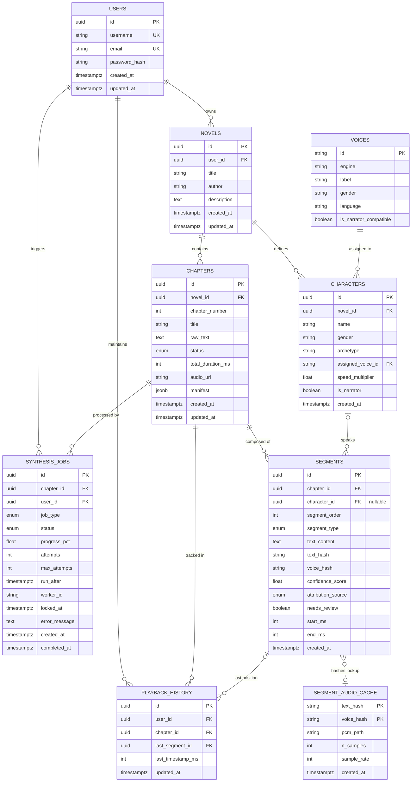
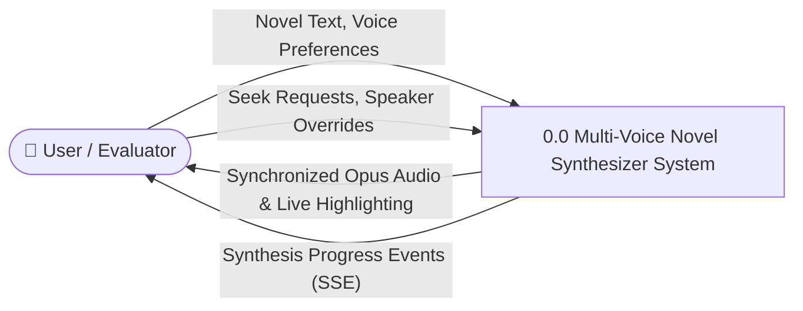
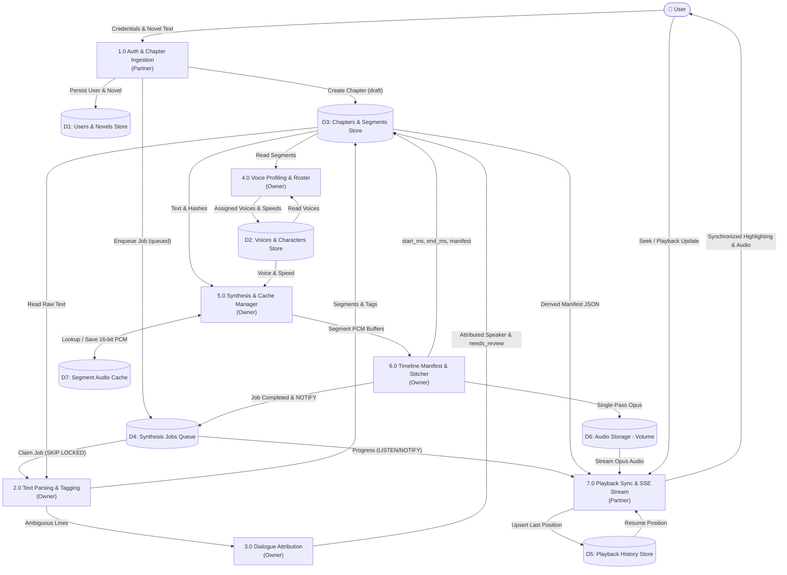

### Why was the diagram orange and cluttered?

In Mermaid, putting nodes into two separate `subgraph` blocks causes the markdown renderer to paint large colored boxes behind them (many dark themes default to a bright orange/coral fill). More importantly, because the processes in the two boxes communicate back and forth, the layout engine was forced to draw **crisscrossing arrows through and over text**, creating an unreadable "spiderweb."

Below is the clean, professionally restructured set without chaotic overlapping lines, ready for your report and slides.

---

## 1. Entity-Relationship (ER) Diagram

### Key Database Constraints to Highlight:
* `UNIQUE(novel_id, chapter_number)` — Prevents duplicate chapter indices.
* `UNIQUE(chapter_id, segment_order)` — Guarantees deterministic, linear segment sequencing.
* `UNIQUE(novel_id, name)` — Prevents character name collisions within the same novel.
* `UNIQUE(user_id, chapter_id)` — Enables clean atomic upserts for playback history.
* `CREATE UNIQUE INDEX ON characters(novel_id) WHERE is_narrator;` — Enforces at most one narrator per novel.
* `SEGMENTS.start_ms / end_ms` is the **authoritative relational state**; `CHAPTERS.manifest` is a **derived JSONB read cache**.

---

## 2. Tech Stack & Database Architecture

| Layer | Technology | Role & Academic / Engineering Justification |
|---|---|---|
| **Frontend Framework** | **React 18 + Vite + JavaScript (JSX) + Tailwind CSS** | Fast reactive SPA. Uses a continuous `requestAnimationFrame` loop that polls the HTML `<audio>` clock for smooth 60fps text highlighting without UI stutter. |
| **Input Sanitization** | **`tts-dom-cleaner` (npm)** | Your published npm package. Runs client-side in the browser to strip ads, author notes, site navigation, and ruby tags from pasted web novels/EPUBs before upload. |
| **Backend API Framework**| **Express.js (JavaScript / Node.js 20+)** | High-concurrency async REST API Gateway for auth, chapter ingestion, OpenStack Swift range streaming, and WebSocket / SSE event streaming. |
| **Primary DBMS** | **PostgreSQL 16** | The core relational database (3NF). Also serves as the **task queue broker** using `FOR UPDATE SKIP LOCKED` (eliminating Redis/Celery) and broadcasts real-time progress via `pg_notify`. |
| **ORM & Migrations** | **SQLAlchemy 2.0 Async + Alembic** | Type-safe async queries using `asyncpg`; reproducible, version-controlled database migrations. |
| **Real-Time Stream** | **Server-Sent Events (SSE) & WebSocket** | Express holds persistent connections streaming synthesis progress events from PostgreSQL `pg_notify` / worker event bus. |
| **Background Worker** | **Python Daemon Process** | Decoupled worker container that claims jobs from PostgreSQL, runs NLP parsing, executes Kokoro-ONNX TTS, and stitches audio using FFmpeg. |
| **NLP & Parsing** | **Regex Engine + SpaCy (`en_core_web_sm`)** | Fast deterministic quote boundary extraction and grammatical dependency parsing (`nsubj` $\to$ speech verb) for reliable speaker attribution without LLM hallucinations. |
| **TTS & Audio Engine** | **Microsoft Edge Neural TTS (Primary) + Kokoro-ONNX (Fallback)** | Multi-speaker neural voice synthesis with authentic British voices (Harry, Hermione, Ron, Dumbledore, Snape) streamed via Edge WebSocket API (48kbps MP3), with Kokoro-82M offline daemon fallback. |
| **Storage & Deployment**| **Docker Compose (4 Containers) + Shared Volumes** | Multi-container stack (`frontend`, `api`, `worker`, `db`). Shared volumes store model weights, 16-bit PCM cache files, and final chapter `.opus` files. |

---

## 3. Data Flow Diagrams (DFDs)

### 3.1 Level 0 DFD (Context Diagram)
Defines the boundary between the external user and the system.

---

### 3.2 Level 1 DFD (Clean, Linear Subsystem Flow)
*This layout flows cleanly top-to-bottom without crisscrossing lines or distracting orange background boxes. Ownership is clearly stated directly inside the process labels.*

---

### Summary of What This Fixes:
1. **No Orange Boxes**: Removed the competing `subgraph` blocks that triggered the aggressive theme background fills.
2. **Zero Spiderweb Routing**: Rearranged data stores ($D_1$ to $D_7$) and processes ($1.0$ to $7.0$) into an orderly downward flow.
3. **Explicit 2-Person Ownership**: Ownership is cleanly indicated directly inside each process box (`(Owner)` vs `(Partner)`).
4. **Presentation Ready**: Renders legibly in light mode, dark mode, Typora, GitHub, and thesis export tools.